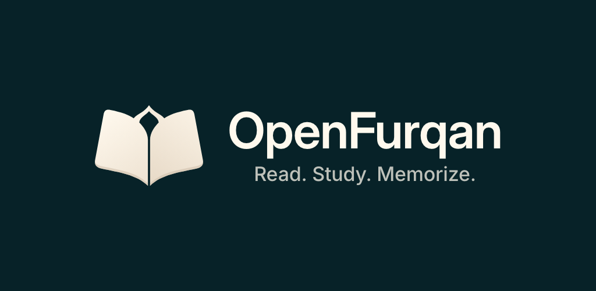
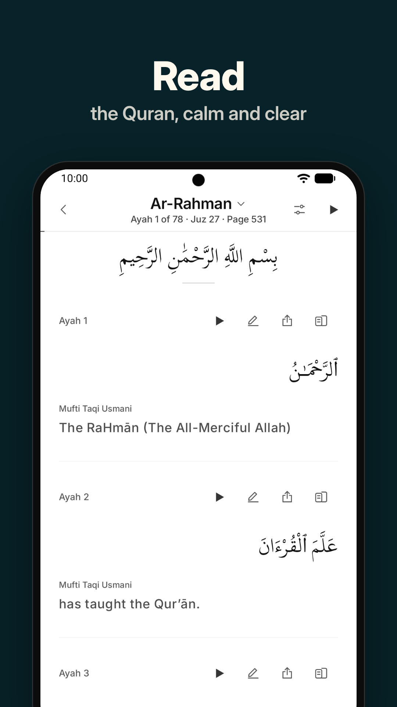
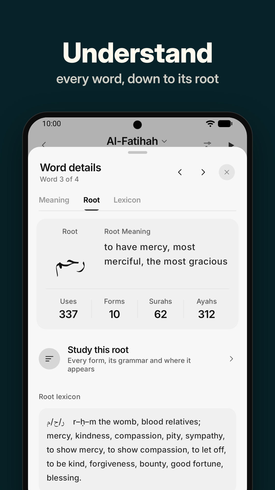
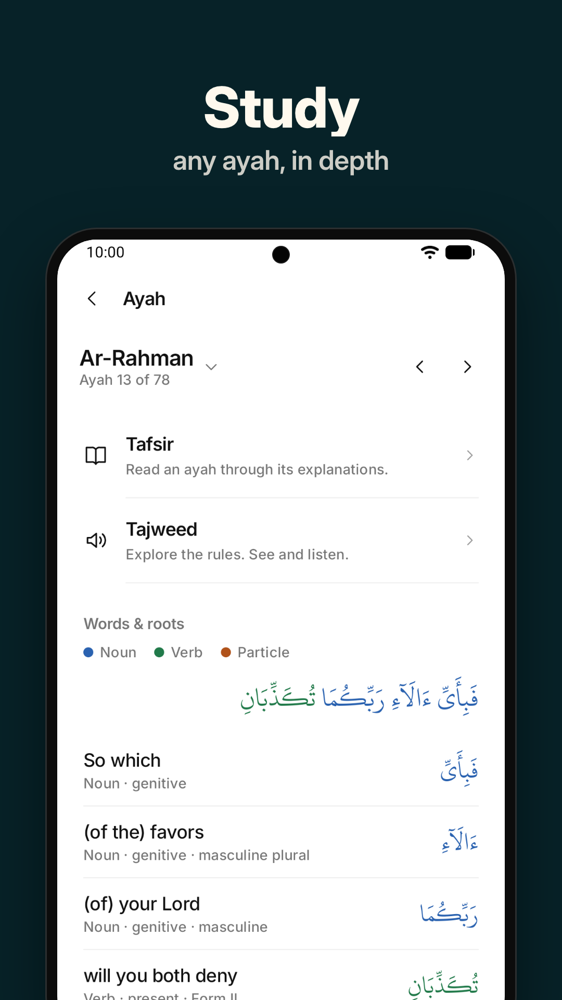
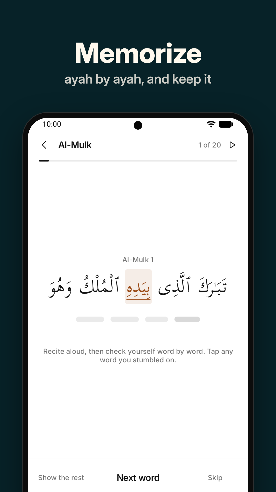
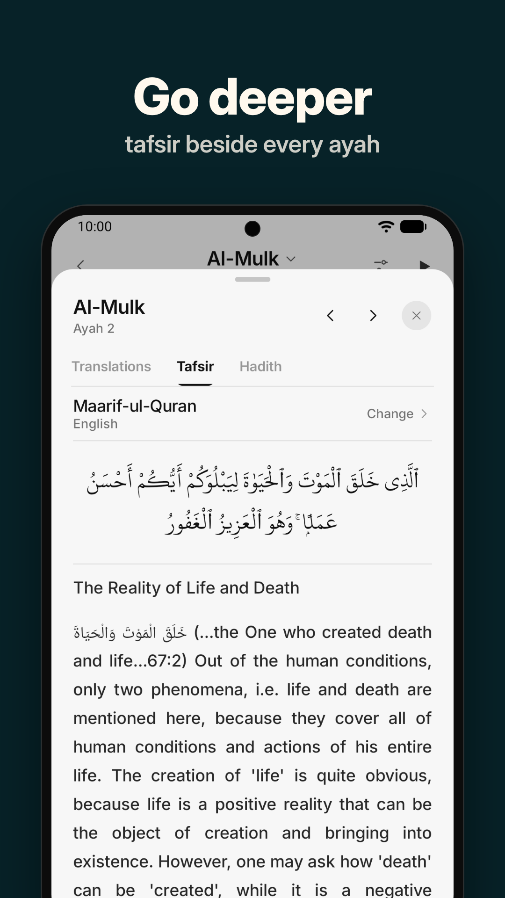
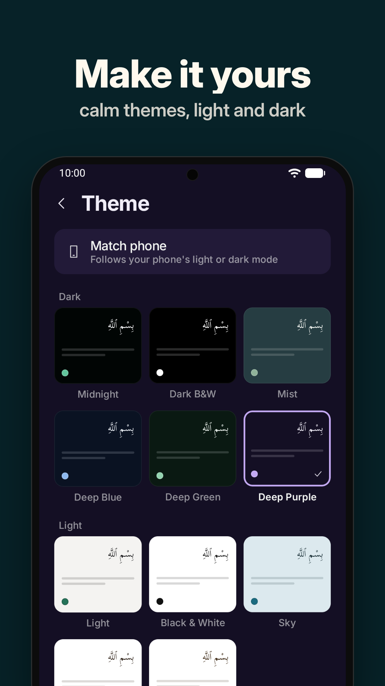
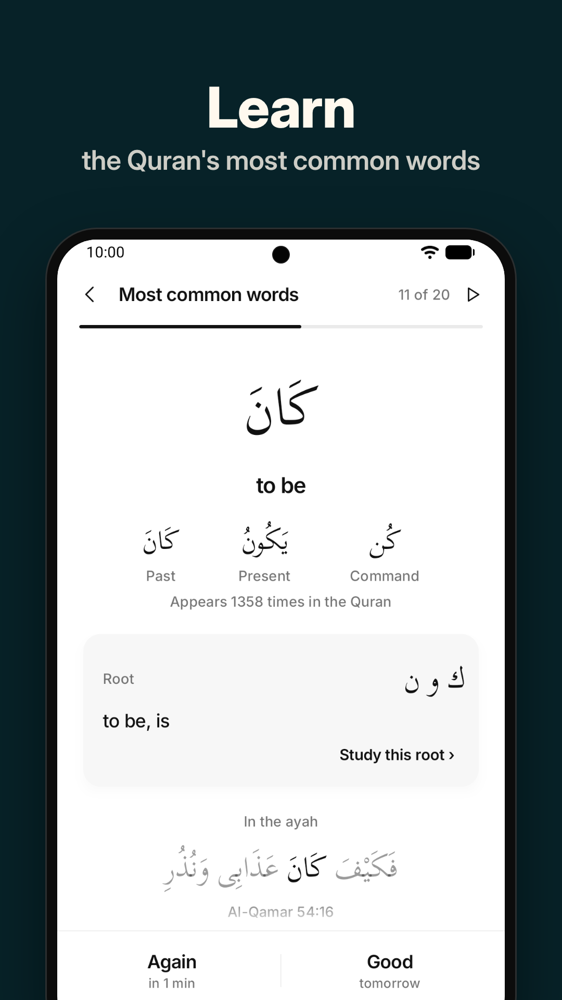

  

  <a href="https://play.google.com/store/apps/details?id=com.openfurqan.app"><b>Get it on Google Play</b></a> ·
  <a href="https://openfurqan.com">openfurqan.com</a> ·
  <a href="CHANGELOG.md">What's new</a>

# OpenFurqan for Android

A calm Quran app for reading, studying and memorizing the Quran with understanding. Open any word to see
its meaning and root, read the hadith beside each ayah, and compare translations and tafsirs side by side.

  
  
  
  

  
  
  
  

## Read
- Surah, Juz and the 604-page Mushaf
- Translations in 75 languages, and 44 tafsirs
- Word-by-word meanings and transliteration under every ayah
- A choice of Arabic fonts, tajweed colours and a quiet focus mode

## Listen
- 16 reciters, the text following the recitation, most word by word
- Repeat an ayah, a range or a whole surah; keep listening in the background
- Hear any single word pronounced

## Study
- Tap a word for its grammar, its root and its entry in Lane's Lexicon
- Every one of the Quran's 1,651 roots, with every word built from it and every ayah it appears in
- Hadith from seven collections, beside the ayahs they speak of
- Search by Arabic, translation, word meaning, root or ayah number
- A notebook for written and voice notes, and saved ayahs

## Memorize
- Memorize ayahs: uncover them word by word as you recite, and review them when they're due
- Learn the Quran's vocabulary with daily review, one word and its root at a time

## Private by design
No account, no ads, no tracking. Your notes, bookmarks, recordings and progress stay on your phone.
[Privacy policy](https://openfurqan.com/privacy)

The app is in English, বাংলা, हिन्दी and اردو.

## Feedback
- **Found a bug?** [Report it](../../issues/new?template=bug_report.yml)
- **Have an idea?** [Suggest a feature](../../issues/new?template=feature_request.yml)
- Or write to **contact@openfurqan.com**

This repository holds the app's release notes and its bug reports and suggestions.
